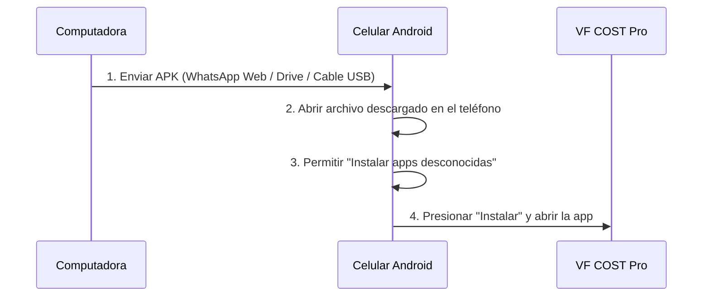
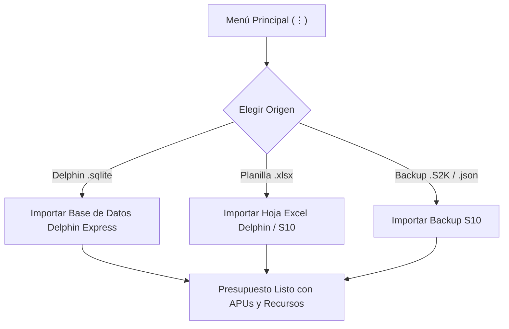
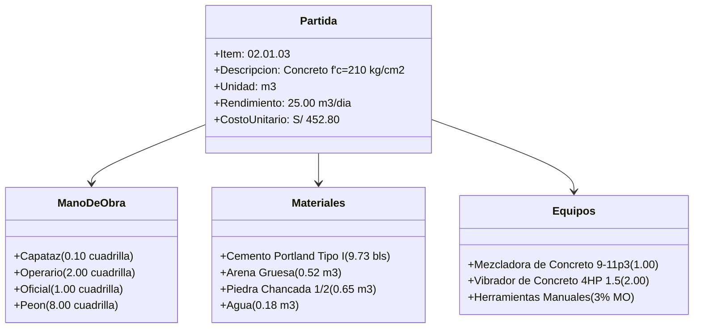
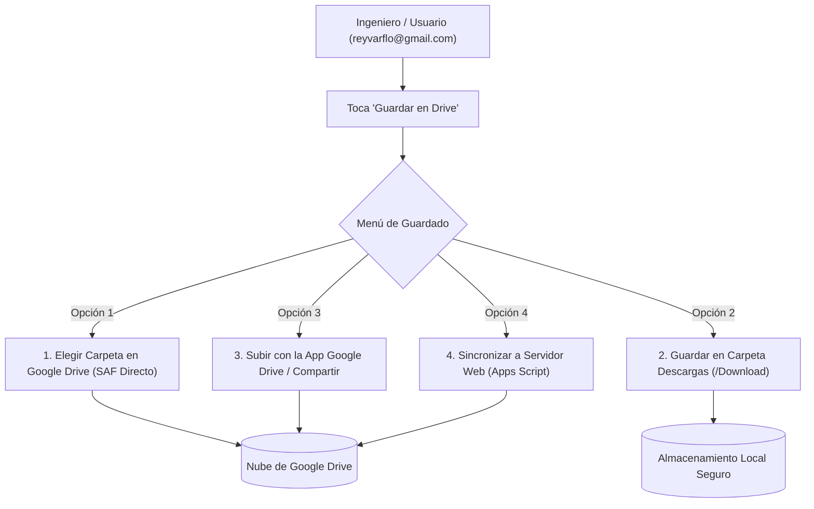

# 📘 MANUAL DE USUARIO OFICIAL: VF COST PRO
### *Sistema Integral de Presupuestos, Costos Unitarios y Control de Obras (S10 & Delphin Express BIM 360)*
**Versión de la Aplicación:** 2.0.0 Pro  
**Identidad Corporativa:** Paleta Oficial VARFLO (Azul Marino `#0F2B48`, Naranja Construcción `#FF6D00`, Gris Técnico `#F1F5F9`)  
**Estándar Normativo:** Contraloría General de la República del Perú • OSCE • D.S. N° 011-79-VC • MTC  

---


---

## 📑 ÍNDICE GENERAL DE CONTENIDOS

1. [Presentación e Identidad de VF COST Pro](#1-presentación-e-identidad-de-vf-cost-pro)
2. [Instalación del APK en Celulares y Tablets Android](#2-instalación-del-apk-en-celulares-y-tablets-android)
3. [Pantalla Principal y Portafolio de Proyectos](#3-pantalla-principal-y-portafolio-de-proyectos)
4. [Creación de un Nuevo Presupuesto de Obra](#4-creación-de-un-nuevo-presupuesto-de-obra)
5. [Importación de Datos (Delphin .sqlite / Excel / S10)](#5-importación-de-datos-delphin-sqlite--excel--s10)
6. [Estructuración del Presupuesto (Subpresupuestos y WBS)](#6-estructuración-del-presupuesto-subpresupuestos-y-wbs)
7. [Gestión de Partidas, Títulos y Metrados](#7-gestión-de-partidas-títulos-y-metrados)
8. [Análisis de Precios Unitarios (APU) al Detalle](#8-análisis-de-precios-unitarios-apu-al-detalle)
9. [Pie de Presupuesto, Gastos Generales y Liquidación](#9-pie-de-presupuesto-gastos-generales-y-liquidación)
10. [Incidencia de Costos y Fórmula Polinómica (D.S. 011-79-VC)](#10-incidencia-de-costos-y-fórmula-polinómica-ds-011-79-vc)
11. [Respaldo y Sincronización en la Nube (Google Drive y Red)](#11-respaldo-y-sincronización-en-la-nube-google-drive-y-red)
12. [Generación de Expediente Técnico en PDF y Exportación Excel / MS Project](#12-generación-de-expediente-técnico-en-pdf-y-exportación-excel--ms-project)
13. [Solución de Preguntas Frecuentes (FAQ)](#13-solución-de-preguntas-frecuentes-faq)

---

## 1. PRESENTACIÓN E IDENTIDAD DE VF COST PRO

**VF COST Pro** es una plataforma móvil de ingeniería de costos diseñada para ingenieros civiles, arquitectos, contratistas y tasadores en el Perú. Permite elaborar expedientes técnicos completos compatibles con **S10 Presupuestos** y **Delphin Express BIM 360**.

### Características Esenciales:
* **Formato Numérico Oficial de Ingeniería Civil Peruana:** Formatea cifras mayores al millón con apóstrofe de millones (`'`), comas para miles y punto para decimales (ejemplo: `S/ 1'325,125.25`, `S/ 21'426,672.57`).
* **Costo Legal en Letras Automatizado:** Todo presupuesto genera la glosa legal requerida por el Estado:
  > *`SON: UN MILLÓN TRESCIENTOS VEINTICINCO MIL CIENTO VEINTICINCO Y 25/100 SOLES`*
* **Paleta Corporativa Oficial VARFLO:**
  * **Azul Marino Principal:** `#0F2B48` (Cabeceras, degradados y jerarquía).
  * **Naranja Construcción:** `#FF6D00` / `#FF7A00` (Botones de acción dinámica, totales y alertas).
  * **Gris Técnico:** `#F1F5F9`, `#CBD5E1`, `#1E293B` (Superficies de lectura y contraste).

---

## 2. INSTALACIÓN DEL APK EN CELULARES Y TABLETS ANDROID

El instalable listo para producción se encuentra en su computadora:
* **Archivo:** `VFCOST_Pro_Release.apk` (61.1 MB).
* **Ruta de acceso:** `H:\APP PRESUPUESTO VFCOST\VFCOST_Pro_Release.apk`.

### Procedimiento de Instalación Paso a Paso:



1. **Transferir el APK al Celular:**
   * **Por WhatsApp Web o Telegram:** Arrastre `VFCOST_Pro_Release.apk` a su chat personal y descárguelo en el teléfono.
   * **Por Google Drive:** Súbalo a su cuenta de Drive y descárguelo en el dispositivo.
   * **Por Cable USB:** Conecte el celular a la PC y copie el archivo a la carpeta `Download` (Descargas).
2. **Permitir Instalación:**
   * Al abrir el archivo, Android preguntará: *"¿Deseas instalar esta aplicación?"*.
   * Si es la primera vez, toque **Configuración** y active la casilla **"Confiar en esta fuente"**.
3. **Instalar:**
   * Toque **Instalar** y espere 5 segundos. Toque **Abrir** para iniciar VF COST Pro.

---

## 3. PANTALLA PRINCIPAL Y PORTAFOLIO DE PROYECTOS

Al abrir la aplicación, observará la pantalla de inicio estructurada de la siguiente manera:

```
┌────────────────────────────────────────────────────────────┐
│ [Logo] VF COST Pro                      (☁ Drive) (⊞) (⋮)  │
│        S10 & Delphin Express BIM 360                       │
├────────────────────────────────────────────────────────────┤
│ 🔍 Buscar proyectos por nombre, código o cliente...        │
├────────────────────────────────────────────────────────────┤
│ [TODOS (7)] [Edificaciones (2)] [Viales (1)] [Saneamiento] │
├────────────────────────────────────────────────────────────┤
│ ┌────────────────────────────────────────────────────────┐ │
│ │ 🔓 EDIFICACIONES     Costos al: 24 Oct 2026        (⋮) │ │
│ │ MEJORAMIENTO DEL SERVICIO EDUCATIVO SECUNDARIA         │ │
│ │ MUNICIPALIDAD DE LIMA • LIMA - LIMA                    │ │
│ │ ────────────────────────────────────────────────────── │ │
│ │ COSTO DIRECTO (C.D.)       TOTAL PRESUPUESTO (CON IGV) │ │
│ │ S/ 1'123,072.25            S/ 1'325,125.25             │ │
│ │ 📖 SON: UN MILLÓN TRESCIENTOS VEINTICINCO MIL...       │ │
│ └────────────────────────────────────────────────────────┘ │
│                                                            │
│                                  [ + Nuevo Presupuesto ]   │
└────────────────────────────────────────────────────────────┘
```

### Componentes de la Pantalla Principal:

1. **Barra Superior (AppBar Varflo):**
   * **Logo Oficial:** Isotipo en círculo blanco.
   * **Botón Nube (☁ Drive):** Acceso instantáneo a la pantalla de sincronización con Google Drive y la red.
   * **Mosaicos Delphin (⊞):** Opciones rápidas de maestros de Delphin Express.
   * **Menú General (⋮):** Respaldos rápidos, optimización de base de datos e importaciones.
2. **Barra de Búsqueda Dinámica:**
   * Escriba cualquier palabra para filtrar al instante por código (ej. `0101001`), cliente o nombre de la obra.
3. **Píldoras Modernas de Filtro por Especialidad:**
   * Botones con degradado azul y contador naranja dinámico:
     * `TODOS`: Muestra la totalidad de proyectos.
     * `Edificaciones`, `Agua potable y alcantarillado`, `Obras Viales`, `Educativa`, `Obras Hidráulicas`, `Drenaje Pluvial`.
4. **Tarjetas de Proyecto (PresupuestoSummaryCard):**
   * **Línea de Acento Vertical:** Azul si es editable; naranja si está bloqueado.
   * **Candado Delphin (🔒 / 🔓):** Bloquea la obra para evitar modificaciones accidentales en obra o auditorías.
   * **Costo Directo y Total:** En formato `S/ 1'325,125.25`.
   * **Banner Costo en Letras:** Transcripción legal automática.
5. **Botón Flotante Moderno:**
   * `[ + Nuevo Presupuesto ]` en naranja corporativo Varflo.

---

## 4. CREACIÓN DE UN NUEVO PRESUPUESTO DE OBRA

Para crear un proyecto desde cero:

1. Toque el botón flotante **`+ Nuevo Presupuesto`**.
2. Complete la ventana de diálogo **Datos Principales del Proyecto**:
   * **Código del Proyecto:** Se autogenera correlativamente (ej. `0101008`).
   * **Nombre de la Obra:** Ej. *"CONSTRUCCIÓN DE PISTAS Y VEREDAS EN EL DISTRITO DE SAN MARTÍN"*.
   * **Cliente / Entidad Contratante:** Ej. *"MUNICIPALIDAD DISTRITAL DE SAN MARTÍN"*.
   * **Ubicación:** Ej. *"LIMA - LIMA - PERÚ"*.
   * **Tipo / Naturaleza de Obra:** Seleccione *Obras Viales*, *Edificaciones*, etc.
   * **Moneda:** Soles (`S/`) o Dólares Americanos (`US$`).
   * **Jornada Laboral:** 8.00 horas estándar (o 8.5h según régimen especial).
   * **Plazo de Ejecución:** En días calendario (ej. `180 días`).
3. Toque **Guardar**. La aplicación abrirá automáticamente el espacio de trabajo del proyecto recién creado.

---

## 5. IMPORTACIÓN DE DATOS (DELPHIN .SQLITE / EXCEL / S10)

Si ya cuenta con presupuestos elaborados en otras plataformas, no necesita digitalizarlos manualmente:



### A. Importación Directa desde SQLite de Delphin Express (`.sqlite`):
1. Vaya al menú superior derecho **(⋮)** y elija **"Importar Delphin (.xlsx / .sqlite / .json)"**.
2. Seleccione la pestaña **"Base de Datos SQLite (.sqlite)"**.
3. Toque **"Seleccionar Archivo SQLite"** y elija la base de datos proveniente de su PC o celular.
4. El motor leerá automáticamente las tablas maestras (`tb_Proyecto`, `tb_Partida`, `tb_Insumo`, `tb_APU`, `tb_Rendimiento`) y cargará el presupuesto completo con sus análisis de costos exactos.

### B. Importación desde Excel (`.xlsx`):
1. Toque **"Importar Delphin (.xlsx)"**.
2. Seleccione la planilla Excel exportada desde Delphin o elaborada con las columnas estándar:
   * `Item` • `Descripción` • `Unidad` • `Metrado` • `Precio Unitario` • `Parcial`.
3. El sistema reconocerá la jerarquía WBS y estructurará títulos y partidas automáticamente.

---

## 6. ESTRUCTURACIÓN DEL PRESUPUESTO (SUBPRESUPUESTOS Y WBS)

Dentro del detalle del proyecto, la obra se organiza mediante la jerarquía civil estándar:

1. **Subpresupuestos (Pestañas Superiores):**
   * Toda obra puede subdividirse en especialidades (ej. *01 ESTRUCTURAS*, *02 ARQUITECTURA*, *03 INSTALACIONES SANITARIAS*, *04 INSTALACIONES ELÉCTRICAS*).
   * Para añadir una especialidad, toque el chip **`+ Subpresupuesto`** en la barra horizontal.
2. **Conmutador de Vista Dividida (Split Screen BIM 360):**
   * En la barra superior, toque el icono de **Vista Dividida** (`◫`).
   * La pantalla se dividirá en dos paneles:
     * **Panel Superior:** Hoja de presupuesto con árbol de partidas.
     * **Panel Inferior:** Insumos de la partida seleccionada y gráfico de incidencia en tiempo real.

---

## 7. GESTIÓN DE PARTIDAS, TÍTULOS Y METRADOS

### Estructura de la Hoja de Presupuesto:
* **Títulos (Nivel 1, 2, 3):** Filas sombreadas en gris/azul que agrupan partidas (ej. `01 OBRAS PROVISIONALES`, `01.01 CONSTRUCCIONES PROVISIONALES`).
* **Partidas (Nivel de Análisis):** Ítems que contienen metrado, precio unitario y análisis de costos APU (ej. `01.01.01 CARTEL DE IDENTIFICACIÓN DE OBRA`).

```
01 OBRAS PRELIMINARES [Título Nivel 1]
 ├── 01.01 LIMPIEZA DEL TERRENO [Título Nivel 2]
 │    └── 01.01.01 LIMPIEZA MANUAL (m2) [Partida - Tiene APU]
 └── 01.02 TRAZO Y REPLANTEO [Título Nivel 2]
      └── 01.02.01 TRAZO DURANTE LA OBRA (m2) [Partida - Tiene APU]
```

### Operaciones Disponibles en Cada Fila:

* **Expandir / Contraer Títulos:** Toque la flecha (`⌄` / `›`) para ocultar o mostrar partidas hijas y trabajar cómodamente en obras grandes.
* **Nueva Partida o Título:** Toque el botón flotante inferior:
  * `[T]` para insertar un Título.
  * `[+] Partida` para insertar una Partida analizada.
* **Sangría Jerárquica (WBS):** Use los controles de indentación derecha (`→`) e izquierda (`←`) para subir o bajar el nivel del ítem (ej. pasar de `01.01` a `01.01.01`).
* **Indicador APU (Flecha Verde ↑):** Indica que la partida tiene insumos asignados. Al tocarla se ingresa directo al análisis de costos.
* **Especificaciones Técnicas ([A]):** Abre la ficha técnica de la partida (descripción, método de medición y bases de pago).

---

## 8. ANÁLISIS DE PRECIOS UNITARIOS (APU) AL DETALLE

Al tocar cualquier partida o su flecha verde (`↑`), se abre el **Editor de APUs**:



### Pestañas Inferiores del Editor de Costos:

1. **[Análisis de C.U]:**
   * Agrupa los insumos en sus 4 categorías oficiales:
     * **MANO DE OBRA:** Se calcula por cuadrilla según la jornada y rendimiento:
       $$\text{Cantidad} = \frac{\text{Cuadrilla} \times \text{Jornada}}{\text{Rendimiento}}$$
     * **MATERIALES:** Aporte por unidad con porcentaje de desperdicio editable (`% Desp.`).
     * **EQUIPOS Y HERRAMIENTAS:** Maquinaria por cuadrilla y herramientas manuales vinculadas al porcentaje de mano de obra (`% MO`, típicamente 3% o 5%).
     * **SUBCONTRATOS:** Servicios especializados de terceros.
   * **Caja de Duración Fija Programada:** Muestra los días calendario exactos requeridos para ejecutar la partida según metrado y rendimiento.
2. **[Especif. técnicas]:** Ficha de especificaciones técnicas con redacción automática editable para licitaciones públicas.
3. **[Metrado Clásico]:** Planilla de dimensiones (Largo $\times$ Ancho $\times$ Alto $\times$ Veces) para justificar el metrado de la partida.
4. **[Metrado Fierro / Xls]:** Planilla para cálculo de acero de construcción clasificado por diámetro ($\frac{1}{4}''$, $\frac{3}{8}''$, $\frac{1}{2}''$, $\frac{5}{8}''$, $\frac{3}{4}''$, $1''$) con conversión automática a kilogramos.
5. **[Σ Consol. de Partida]:** Resumen ejecutivo con totales de insumos y costos parciales.

---

## 9. PIE DE PRESUPUESTO, GASTOS GENERALES Y LIQUIDACIÓN

Acceda a la pestaña **"Pie / GG"** para definir la liquidación final del presupuesto:

1. **Gastos Generales Fijos (G.G.F.):** Gastos que no dependen del tiempo de obra (ej. licitación, compra de bases, seguros contractuales). Ingrese el porcentaje (ej. `2.5%`).
2. **Gastos Generales Variables (G.G.V.):** Gastos directamente proporcionales al plazo de ejecución (ej. sueldos de residente, supervisor, alquiler de camioneta, guardianía). Ingrese el porcentaje (ej. `8.0%`) o use el módulo de **Gastos Generales Desagregados**.
3. **Utilidad:** Margen empresarial del contratista (usualmente entre `5.0%` y `10.0%`).
4. **Subtotal:** Sumatoria de Costo Directo $+$ GGF $+$ GGV $+$ Utilidad.
5. **Impuesto General a las Ventas (I.G.V.):** Casilla de verificación para aplicar el `18.0%` oficial.
6. **PRESUPUESTO TOTAL (CON IGV):** Monto final de la obra formateado en soles (`S/ 1'325,125.25`) y su correspondiente glosa en letras.
7. **Gráfico de Distribución Porcentual:** Gráfico circular interactivo (*Pie Chart*) para verificar la incidencia de cada componente del gasto.

---

## 10. INCIDENCIA DE COSTOS Y FÓRMULA POLINÓMICA (D.S. 011-79-VC)

En la pestaña **"F. Polinómica"**, el motor calcula el reajuste de precios oficial:

$$K = a \frac{J_r}{J_o} + b \frac{M_r}{M_o} + c \frac{E_r}{E_o} + d \frac{V_r}{V_o} + e \frac{GU_r}{GU_o}$$

* **Índices Unificados INEI (IU):** Se agrupan todos los insumos de la obra (Mano de obra IU 47, Cemento IU 21, Acero IU 02, etc.).
* **Condición de Norma:** El sistema valida que la suma de coeficientes de incidencia sea exactamente igual a la unidad:
  $$\sum K = 1.000$$
* Se presenta la matriz con 10 decimales de precisión técnica para evitar observaciones en auditorías de Contraloría.

---

## 11. RESPALDO Y SINCRONIZACIÓN EN LA NUBE (GOOGLE DRIVE Y RED)

La pantalla **Google Drive & Respaldo en la Red** le garantiza que nunca perderá su información técnica:



### ¿Cómo Guardar en Google Drive Paso a Paso?

1. En la pantalla principal, toque el icono de la nube **(☁)** en la barra superior.
2. Ingrese su correo electrónico (ej. `reyvarflo@gmail.com`) y toque el icono de guardar diskette.
3. Presione el botón azul **"Guardar en Drive"**. Aparecerá el menú con 3 alternativas:
   * **Opción 1 (Recomendada / Directa):** *"Elegir carpeta en Google Drive"*.
     * Se abrirá el selector oficial de Android.
     * En el menú lateral izquierdo, seleccione **Google Drive (`reyvarflo@gmail.com`)** $\rightarrow$ **Mi unidad**.
     * Toque **Guardar**. El archivo `.json` quedará almacenado de inmediato en su nube.
   * **Opción 2:** *"Guardar en carpeta Descargas del teléfono"*.
     * Crea una copia instantánea en `/storage/emulated/0/Download/`.
   * **Opción 3:** *"Enviar a la app Google Drive"*.
     * Abre la aplicación de Google Drive instalada para subir el archivo con un toque.

### ¿Cómo Restaurar Proyectos desde Google Drive?

1. En la misma pantalla, presione el botón verde **"Restaurar de Drive"**.
2. Seleccione el archivo de respaldo (`.json` o `.xlsx`) desde su Google Drive o memoria interna.
3. El sistema le consultará si desea:
   * **Añadir / Mantener Ambos:** Agrega los proyectos sin borrar los existentes.
   * **Sobrescribir Existentes:** Reemplaza proyectos que tengan el mismo código.
4. En 2 segundos todos sus presupuestos, partidas y APUs estarán restaurados.

---

## 12. GENERACIÓN DE EXPEDIENTE TÉCNICO EN PDF Y EXPORTACIÓN EXCEL / MS PROJECT

En cualquier momento, dentro del detalle de un presupuesto, toque el icono de **PDF** (`picture_as_pdf`) en la barra superior para generar los documentos listos para firma:

| Tipo de Reporte | Contenido Incluido | Uso Oficial |
| :--- | :--- | :--- |
| **Expediente Completo** | Hoja de presupuesto, APUs completos, relación de insumos y fórmula polinómica en un solo documento encuadernado. | Presentación a Licitaciones / Municipalidades / Gobiernos Regionales. |
| **Hoja de Presupuesto** | Títulos, partidas, unidades, metrados, precios y subtotales con liquidación al pie. | Resumen ejecutivo de costo directo. |
| **Análisis de Costos (APU)** | Desglose completo de cada partida con insumos de mano de obra, materiales y equipos. | Sustento de precios unitarios. |
| **Relación de Insumos** | Listado consolidado de recursos con precios, cantidades y montos totales por IU. | Cotización y adquisiciones en obra. |
| **Fórmula Polinómica** | Monomios de reajuste y factores de ponderación del D.S. 011-79-VC. | Valorizaciones mensuales de obra. |
| **Calendario Valorizado** | Cronograma de desembolsos mensuales por partida y subpresupuesto. | Control de avance de obra. |
| **Exportar Excel (.xlsx)** | Planilla nativa de 4 hojas: Presupuesto, APU, Insumos y Fórmula. | Trabajo en computadora o edición externa. |
| **Exportar MS Project (.xml)** | Archivo XML estándar con tareas WBS y duraciones exactas. | Diagrama de GANTT y ruta crítica (CPM). |

---

## 13. SOLUCIÓN DE PREGUNTAS FRECUENTES (FAQ)

### P1: Modifiqué varios rendimientos en los APUs pero el costo directo no cambia, ¿por qué?
> **Solución:** Toque el botón **"PROCESAR"** (equivalente a la tecla **F9** en S10 / Delphin) ubicado en la barra superior derecha. Esto recalcula en cadena todos los rendimientos, cuadrillas, subtotales y fórmulas polinómicas.

### P2: ¿Puedo usar la aplicación sin conexión a Internet?
> **Respuesta:** **Sí, 100%.** Toda la base de datos funciona de forma local en su celular (`SQLite`). El acceso a Internet únicamente se utiliza cuando usted decide sincronizar o respaldar en Google Drive.

### P3: ¿Cómo transfiero mis presupuestos de un celular a otro?
> **Solución:** En el celular original, vaya a **Guardar en Drive** $\rightarrow$ elija su cuenta. En el nuevo celular, instale el APK, abra la misma pantalla y presione **Restaurar de Drive**.

### P4: ¿Por qué los números aparecen como `S/ 1'325,125.25`?
> **Respuesta:** Es la notación técnica oficial exigida en expedientes técnicos del Perú (Contraloría y MTC). El apóstrofe separa los millones para evitar confusiones de lectura en cifras grandes de obra pública.

---

*Manual elaborado y verificado para la suite VF COST Pro — Versión 2.0.0 Release.*
